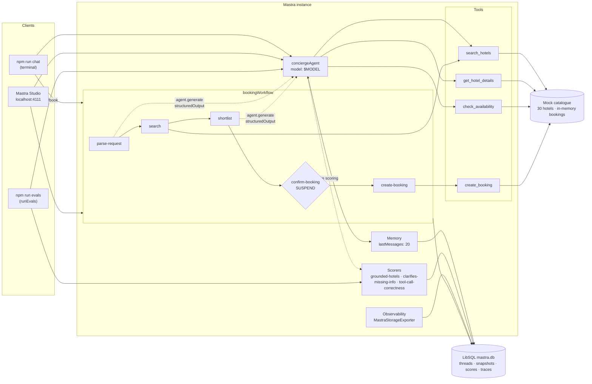

# Hotel concierge agent — a small Mastra demo

A hotel search & booking concierge built with [Mastra](https://mastra.ai). A chat agent turns natural-language requests into typed tool calls over a mock catalogue of 30 hotels, remembers the conversation so follow-ups like "cheaper option?" work, and hands booking off to a workflow that **suspends for human confirmation** before anything is written. Deterministic scorers check that the agent never invents hotels or prices and asks for missing information instead of guessing; every run is traced into the local Studio.

Scope is deliberately an evening's worth: no real booking APIs, no UI beyond Mastra Studio and a tiny terminal CLI.

## Architecture



Key decisions:

- **`create_booking` is not an agent tool.** The agent can search, look up and check availability; a booking only happens inside the workflow after the `confirm-booking` step resumes with `{ confirmed: true }`.
- **The workflow reuses the same agent** for two structured-output calls (parameter extraction, shortlisting) with `toolChoice: 'none'`, and validates every hotel id it returns against the real search results, so the model cannot add a hotel.
- **Scorers are deterministic** (no judge model): they read tool results and assistant text out of the run and compare against the catalogue and the dataset's ground truth. The grounding scorer also runs live on every agent turn, so Studio shows a score next to each conversation.
- **One LibSQL file** (`mastra.db`) holds memory threads, workflow snapshots (suspended runs survive restarts), scores and traces, shared by Studio and the CLI scripts.

## Running it

Requirements: Node 22+, an Anthropic or OpenAI API key.

```bash
npm install
cp .env.example .env        # set ANTHROPIC_API_KEY (or OPENAI_API_KEY + MODEL=openai/...)

npm run dev                 # Mastra Studio at http://localhost:4111 — chat, run the workflow, inspect traces & scores
npm run chat                # terminal chat; /book <request> runs the confirmed booking workflow
npm run evals               # runs the 12-case eval dataset through the agent and prints a score table

npm test                    # vitest: data layer, tools, scorers (no model calls)
npm run typecheck
```

`MODEL` is any Mastra model-router id in `provider/model` form (default `anthropic/claude-sonnet-5-5`; e.g. `anthropic/claude-haiku-5-5` for cheaper eval runs, or `openai/gpt-6.1-sol`). The matching provider key is read from the environment, no provider packages needed.

On start you will see one-time warnings that the storage provider "does not support batch creating metrics/logs/scores". LibSQL stores traces and scores (the Studio traces and scorers views work); the Metrics dashboard needs an observability store such as `@mastra/duckdb`, which this demo leaves out on purpose.

### In Studio

- **Agents → Hotel Concierge**: chat; tool calls, the live `grounded` score and the trace link appear per message.
- **Workflows → booking-workflow**: run with `{ "request": "...", "guestName": "..." }`. The run stops at `confirm-booking` with the proposal in its suspend payload; resume it from the UI with `{ "confirmed": true }` (optionally `"hotelId"` from the alternatives) or `{ "confirmed": false }`.
- **Observability**: traces for every agent run, tool call, workflow step and scorer run.

## Sample conversation

Captured from `npm run chat` (model: `anthropic/claude-sonnet-5-5`). Dimmed lines are the tool calls the CLI prints.

```text
you> Hotels in Barcelona 2027-07-10 to 2027-07-12 for 2, with a pool
→ search_hotels({"city":"Barcelona","checkIn":"2027-07-10","checkOut":"2027-07-12","guests":2,"amenities":["pool"]})
← search_hotels: 2 result(s)
Two Barcelona hotels with a pool are available for 2 guests, 10–12 July 2027 (2 nights):
1. bcn-005 – Montjuïc Hilltop Spa (Sants-Montjuïc) — €290 per night, €580 total, rating 4.8,
   amenities: pool, spa, breakfast, view, restaurant, parking, wifi
2. bcn-002 – Barceloneta Beach Club (Barceloneta) — €210 per night, €420 total, rating 4.5,
   amenities: pool, view, bar, restaurant, gym, wifi
Bcn-005 has the higher rating and includes breakfast and a spa. Bcn-002 is €160 cheaper for the stay.
To book one, tell me which and I'll confirm the details. Then you can run /book <request>.

you> /book 2 nights in Amsterdam from 2027-08-10 for 2 guests under €160 with breakfast
Guest name for the booking: Ada Lovelace
workflow run eebd4e15-…: parsing → searching → shortlisting…

Proposal: Book Oost Family Suites (Amsterdam) for 2 night(s), 2027-08-10 → 2027-08-12, 2 guest(s)
at €150/night = €300? Resume with { confirmed: true } or pick an alternative hotelId.
Alternatives on the shortlist:
  ams-002  De Pijp Budget Hotel  €85/night (€170 total), rating 3.9 — Cheapest at €85/night, includes
  breakfast and fits 2 guests; lower rating (3.9) than Oost Family Suites.
Confirm? [y / n / <hotelId>]: y
resuming workflow…

Booked! bk-967ee255: Oost Family Suites, 2027-08-10 → 2027-08-12, 2 guest(s), €300 total for Ada Lovelace.
```

And the "ask, don't guess" behaviour:

```text
you> I need a hotel in Barcelona for two.
concierge> Happy to help with Barcelona for two guests. What are your check-in and check-out dates?
```

## Evals

`evals/cases.ts` holds 12 fixed scenarios; `evals/run.ts` sends them through `runEvals` against the registered agent. Multi-turn cases use `inputs: [...]` so both turns share one memory thread.

Scorers (all in `src/mastra/scorers/`, all deterministic):

| Scorer | What it checks |
|---|---|
| `grounded-hotels` | Every hotel name in the answer appeared in a tool result (this run or earlier in the thread), and every EUR amount is a returned rate, a stay total or the guest's own budget. Names are matched against the whole catalogue, so "remembered" hotels are caught. |
| `clarifies-missing-info` | With `groundTruth.expectsClarification: true` the agent must ask a question and not search; with `false` it must search. |
| `tool-call-correctness` | `groundTruth.expectedTools` were called with the expected subset of arguments (city, dates, guests, filters, hotel id). Fraction matched. |
| `check-no-tool-errors`, `check-did-not-call('create_booking')` | Mastra quick checks from `@mastra/evals/checks`. |

Results from `npm run evals` on 2026-11-03 with `anthropic/claude-sonnet-5-5` (`—` = scorer not applicable to that case):

| case                     | grounded-hotels | clarifies-missing-info | tool-call-correctness | check-no-tool-errors | check-did-not-call |
| ---                      | ---             | ---                    | ---                   | ---                  | ---                |
| complete-request         | 1.00            | 1.00                   | 1.00                  | 1.00                 | 1.00               |
| filters-budget-amenities | 1.00            | 1.00                   | 1.00                  | 1.00                 | 1.00               |
| missing-dates            | 1.00            | 1.00                   | —                     | 1.00                 | 1.00               |
| missing-city             | 1.00            | 1.00                   | —                     | 1.00                 | 1.00               |
| vague-everything         | 1.00            | 1.00                   | —                     | 1.00                 | 1.00               |
| hotel-details-by-id      | 1.00            | —                      | 1.00                  | 1.00                 | 1.00               |
| availability-check       | 1.00            | —                      | 1.00                  | 1.00                 | 1.00               |
| hallucination-trap-brand | 1.00            | 1.00                   | 1.00                  | 1.00                 | 1.00               |
| unknown-city             | 1.00            | 1.00                   | 1.00                  | 1.00                 | 1.00               |
| booking-attempt-in-chat  | 1.00            | —                      | 1.00                  | 1.00                 | 1.00               |
| follow-up-cheaper        | 1.00            | —                      | 1.00                  | 1.00                 | 1.00               |
| follow-up-second-one     | 1.00            | —                      | 1.00                  | 1.00                 | 1.00               |

Averages: all five scorers 1.00 over 12 cases. The scorers themselves are unit-tested with synthetic stored messages (`src/mastra/scorers/scorers.test.ts`), including the failure cases the table cannot show.

## Project layout

```
src/mastra/
  index.ts                 Mastra instance: agent, workflow, scorers, LibSQL storage, tracing
  agents/concierge-agent.ts
  tools/hotel-tools.ts     search_hotels, get_hotel_details, check_availability, create_booking
  workflows/booking-workflow.ts
  scorers/                 grounded-hotels, clarifies-missing-info, tool-call-correctness
  data/                    types (zod), 30-hotel dataset, catalog (search/availability/bookings)
evals/                     cases.ts (dataset), run.ts (runEvals + table)
scripts/chat.ts            terminal demo
```

## Notes on Mastra

TODO

## License

MIT
